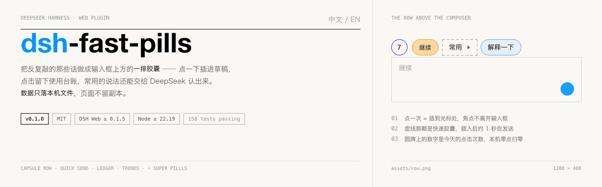
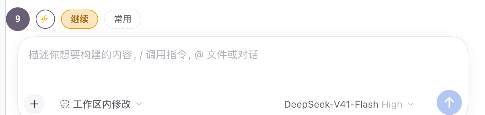
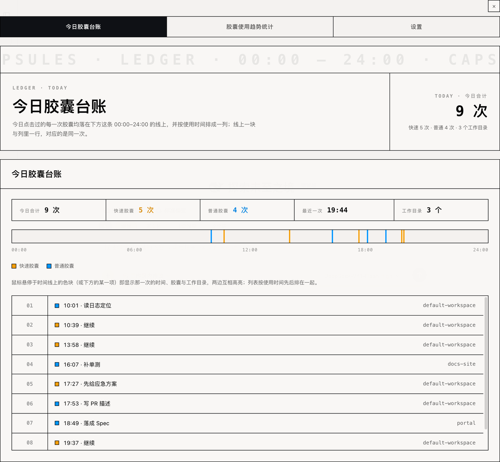
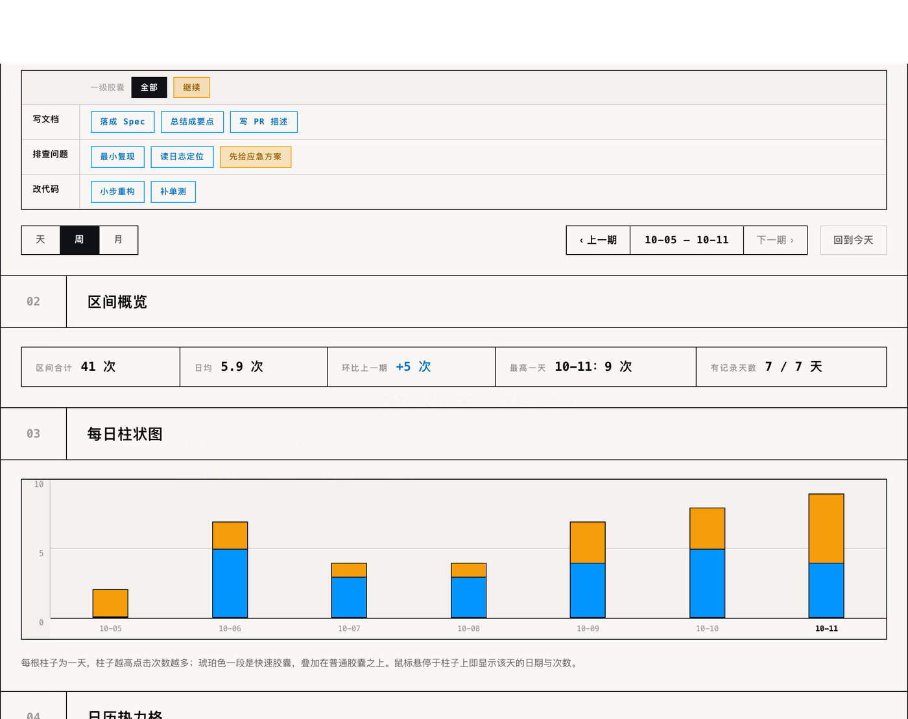
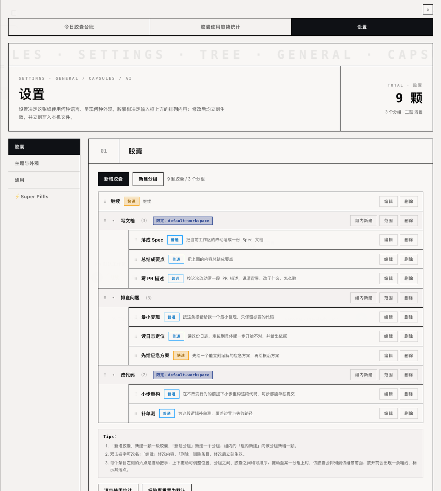
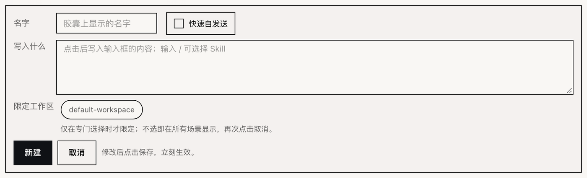
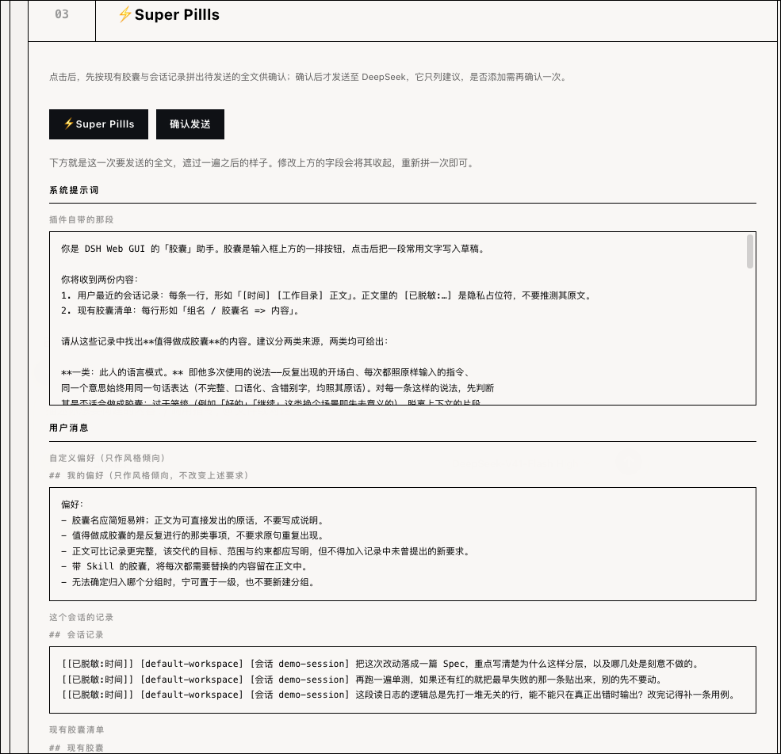
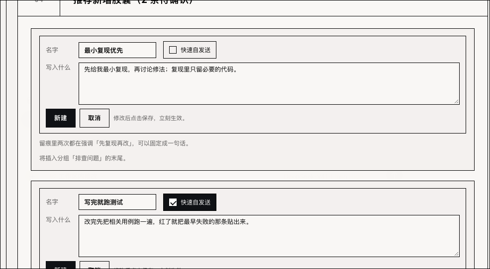

<div align="center">



# dsh-fast-pills

给 DSH Web GUI 的**常用话胶囊插件** —— 把反复敲的那些话排在输入框上方，点一下插进草稿；点击留下使用台账，常用的说法还能交给 DeepSeek 认出来。

中文 / [English](README.en.md)

[演示](#演示) · [特性](#特性) · [安装](#安装) · [首次使用](#首次使用) · [配置](#配置) · [开发](#开发)

<p>
  <a href="LICENSE"></a>
  
  
  
  
  
</p>

</div>

***

## 这是什么

你在 DSH Web 里总会重复输入同一类话：「继续」「把这次改动落成 Spec 文档」「近两周的 Bug 逐个澄清」。这个插件把它们存成**胶囊**，排在输入框正上方，一次点击就把正文插到光标处；点击本身还会记一条流水，于是「今天按了几次、按了哪颗」也有据可查。

- **给谁用**：每天在 DSH 里反复交代同类指令的人。
- **解决什么**：省掉重复输入，让常用说法和它的使用情况都留在本机。
- **不做什么**：不改页面结构、不替你做决定 —— 插进去的正文改不改、发不发仍由你说了算。

## 演示

<p align="center">
  
</p>

**一行胶囊就在输入框正上方**：行首圆牌写今天的点击次数（按本机零点切分），实心琥珀那颗是快速胶囊，虚线的是分组。

<p align="center">
  
</p>

**今日胶囊台账**：指标格 + 00:00–24:00 时间线 + 按时间排好的记录列表；鼠标移到色块或某一行，两边互相高亮。

<p align="center">
  
</p>

**胶囊使用趋势统计**：一张小表选区间与胶囊，配「天 / 周 / 月」与区间概览、每日柱状图、日历热力格、每日明细。

<p align="center">
  
</p>

**胶囊树编辑器**：新增、就地改名、拖动排序、拖进拖出分组，一行写完这颗胶囊会在哪儿出现、点一下插什么。

<p align="center">
  
</p>

**新建一颗胶囊**：名字是按钮上的字，「写入什么」是点一下插进草稿的正文（打一个 `/` 就能挑 Skill），底下选限定工作区。

<p align="center">
  
  
</p>

**⚡Super Pillls**：左边是发送前给你过目的全文（系统提示词 / 你的偏好 / 会话记录 / 现有胶囊，已遮一遍）；右边是模型给的建议，每条都是一张表单，按「新建」才入树。

> 上面几张都是从真引擎、真浏览器上截的，不是示意图；胶囊内容是为截图临时造的一份。

## 特性

### 一点即用

点胶囊把文字插到光标处（插入，不是替换），**焦点不离开输入框**，一次插入算一次撤销。带 Skill 的胶囊插 `/Skill名 正文 `，不带的只插正文。

### 快速胶囊：点完自己发出去

标成「快速」的胶囊插入后约 1 秒自动提交**整份草稿**（框里原有的字一起发走），外观是实心琥珀底 —— 适合「继续」这类你本来就要按回车的话。等多久可以在「设置 → 通用」里改成 0.5 / 1 / 2 / 3 秒。

### 分组与限定：一行装不下的时候

一级条目有两种：一颗可点的胶囊，或一颗可展开的组胶囊。组最多两级；**点组胶囊只开合**、不插入任何文字，开合状态不写进文件，刷新回到全折叠。

胶囊和分组都能**限定工作区**：只在选中的工作区（含子目录）里出现，一条都不选就是处处可见。可选范围就是页面已经认得的那几个工作区，一枚 chip 一个，不用手打路径；分组的限定与胶囊自己的取并集 —— 任一边命中就显示。

### 今日胶囊台账

一横条指标格（今日合计 / 快速胶囊 / 普通胶囊 / 最近一次 / 工作目录），一条 00:00–24:00 的时间线，一份按时间排好的记录列表。跨工作目录统一画在同一条线上，只用两种颜色区分快速与普通。

### 胶囊使用趋势统计

一张小表选区间与胶囊：第一行是「全部」加没进分组的一级胶囊，第二行起是分组名与组里的胶囊，每颗只出现一处。**天**按本机时区的当天零点切分，**周**从周一起算，**月**按自然月，配「‹ 上一期 / 这一期 / 下一期 ›」。

选「天」时下面画的就是那一天的台账（一天的量用一根柱子说不清楚）；选「周」「月」给四张卡：区间概览、每日柱状图、日历热力格、每日明细。

### 胶囊树编辑器

树里每行写显示名与它会插入什么。双击名字就地改名；点行上的空白开合自己的编辑器；拖动排序，落点画成一条 5px 墨线，胶囊还能拖进拖出分组。删组时会问组里的胶囊一起删还是升到一级，空分组直接删掉。树底下一块 Tips（1 / 2 / 3）把手势说一次。

### 米白纸 + 纯黑墨

抽屉与插件卡片是一整套纸墨风格：直角、一像素实线、等宽数字、悬浮整块反色。有浅色与深色两张纸；「设置 → 主题与外观」里还能换**普通胶囊 / 快速胶囊 / 风格色彩 / 限定标记**四支颜色，每支只挑一个色号，悬停、淡底与两处文字色全由它算出来（含实际对比度）。改完立刻生效，也立刻写进本机设置文件。

> 输入框上那排胶囊行不属于这套纸墨，仍是产品自己的圆角胶囊 —— 它要和输入框旁边的控件站在一起。

### ⚡Super Pillls：让 DeepSeek 认胶囊

你每发一条消息，插件把**用户输入**记一条（助手回复从不记录）。点识别之后：读会话记录与现有胶囊 → 遮一遍 → 拼出完整请求给你过目 → 你按「确认发送」才真的发出去 → 模型回 1–3 条建议，每条都是一张「新建胶囊」表单，按「新建」才入树。

- **两道脱敏**：记录**落盘前**遮一遍，出本机**前**再遮一遍，遮的是你的内容（会话记录 / 现有胶囊 / 自定义提示词）；插件自带的那段系统提示词原样过去。
- **key 不出进程**：key 由宿主半保存与使用，页面只看得见「配没配」和一个指纹（SHA-256 前 8 位），任何路由都拿不回明文。
- **不依赖周围的 DSH**：只接 DeepSeek 官方 Messages 端点，模型、端点、提示词、取样参数都在这一页配。

### 想关就关

侧栏「插件 → dsh-fast-pills」这张卡片上有一颗开关：关掉之后整排胶囊（含行首圆牌）都不再出现，要再打开就回这一页。卡片下面还有三条图文使用说明。

## 安装

### 环境要求

| 项 | 要求 |
| --- | --- |
| DSH | Web GUI ≥ `0.1.5-rc.2`（能装 profile bundle 的版本），本仓库在 `0.2.0-rc.2` 上验收 |
| Node.js | `>= 22.19`（只有本机自己构建时才需要） |
| 系统 | 跟随 DSH Web：macOS / Windows / Linux 都行，本仓库在 macOS 上验收 |
| 可选 | DeepSeek API key —— 只有 ⚡Super Pillls 需要 |

### 方式一：命令

```bash
# 从 npm 装
dsh plugin --profile web add dsh-fast-pills

# 或直接从 GitHub 装：仓库里带着构建好的 lib/，装的人不需要本机再构建
dsh plugin --profile web add https://github.com/RonnyJung2021/dsh-fast-pills
```

> **GitHub 直装靠的是仓库里那份 `lib/`，别改成「装完再构建」。** pnpm 默认拒绝执行 git 依赖的
> 构建脚本（`ERR_PNPM_GIT_DEP_PREPARE_NOT_ALLOWED`），除非本机在 profile 的
> `pnpm-workspace.yaml` 里把包加进 `onlyBuiltDependencies`。所以构建产物入库、构建挂在 `prepack`
> 上，git 安装既不用构建也不用放行。

装完**重启一次 `dsh web`**：宿主半是引擎启动时加载的，只刷新页面看不到新的路由。

### 方式二：插件页

侧栏 **插件** → **添加 bundle** → 填 `dsh-fast-pills`（或上面那个 GitHub 地址）→ 装上并启用。

### 方式三：本机开发时从工作目录装

```bash
node scripts/install-profile.mjs --home /path/to/home              # 装
node scripts/install-profile.mjs --home /path/to/home --dry-run    # 只打印将改动什么
node scripts/install-profile.mjs --home /path/to/home --uninstall  # 卸
```

它写 profile `package.json` 里的 `link:` 依赖与包名、`node_modules/<包名>` 软链，每个被改的文件
先备份成 `*.bak-dsh-fast-pills`，并打印它动了哪些路径。三条路都要求那个 home 的 `web` profile
已经存在（先跑一次 `dsh web` 就会生成）。

> 想先拿一份干净的家目录试装（不动日常那个 `~/.dsh`）：

```bash
DSH_HOME=/tmp/dsh-clean-home dsh web --no-open --port 0    # 先起一次，生成 web profile
node scripts/install-profile.mjs --home /tmp/dsh-clean-home
DSH_HOME=/tmp/dsh-clean-home dsh web --no-open --port 0    # 终端打印带 ?token= 的地址
```

### 首次使用

1. 打开任意会话，输入框上方应该出现种子胶囊行：一颗快速的「继续」，一颗组胶囊「常用」（里面是「解释一下」与「总结成要点」）。
2. 点「继续」：草稿里出现文字，约 1 秒后自动发出去。
3. 点行首圆牌，抽屉从右侧展开，默认停在「今日胶囊台账」，刚才那一次已经在列表里。

要加自己的胶囊：抽屉 →「设置」→「胶囊」→「新增胶囊」。**名字**是按钮上显示的字，**写入什么**是点一下插进草稿的正文；在「写入什么」里打一个 `/` 会列出这个项目已装的 Skill，挑一个就把 `/名字` 写进去。

### 卸载

```bash
dsh plugin --profile web remove dsh-fast-pills
# 或者从工作目录装的那份：
node scripts/install-profile.mjs --home "${DSH_HOME:-$HOME/.dsh}" --uninstall
```

插件加载与样式一起消失；数据仍留在本机目录里，要一并清掉就删掉它（见 [存储](#存储)）。

> 卸载前建议先把胶囊树导出留档 —— 目前还没有导入导出功能，见 [Roadmap](#roadmap)。

## 配置

设置都在抽屉的「设置」Tab 里改，改完立刻生效并写进本机 `settings.json`。API key 不在这个文件里，单独存 `secret.json`（0600）。

| 项 | 位置 | 默认值 | 说明 |
| --- | --- | --- | --- |
| 界面主题 | 设置 → 主题与外观 | 跟随产品 | 浅色米白纸 / 深色黑纸白墨 / 跟随产品 |
| 四支颜色 | 设置 → 主题与外观 | 蓝 `#0095FF`、橙 `#F59E0B`、米色系、藏青 `#1E3A8A` | 每支可挑色板或填 `#rrggbb`；悬停、淡底与文字色自动派生 |
| 界面语言 | 设置 → 通用 | 中文 | 中文 / English；中文为原文，英文依其翻译 |
| 快速胶囊延时 | 设置 → 通用 | 1 秒 | 0.5 / 1 / 2 / 3 秒 |
| 抽屉宽度 | 设置 → 通用 | 页面的 85% | 70 / 85 / 100 |
| 显示胶囊行 | 插件卡片 | 开 | 关掉后输入框上方整排消失 |
| 模型 | 设置 → ⚡Super Pillls | `deepseek-flash` | 识别请求用的模型 id |
| 接口地址 | 设置 → ⚡Super Pillls | `https://api.deepseek.com/anthropic` | 留空回官方端点；只有网关部署需要改 |
| 自定义偏好 | 设置 → ⚡Super Pillls | 预置一段做胶囊的偏好 | 随用户消息发出，只影响语气与措辞，改不了规则与格式 |
| 推理程度 | 更多设置（取样参数） | 低 | 关闭即不思考直接作答；低 / 高 / 最高开启思考，越高越慢 |
| `temperature` | 更多设置（取样参数） | `0.2` | 关掉推理时生效（0–1）；**开启推理时该参数不生效** |
| `top_p` | 更多设置（取样参数） | `1` | 只在推理模式下生效（下限 0.95）；关闭推理时恒为 1.0 |
| `max_tokens` | 更多设置（取样参数） | `4096` | 正文与思考**共用**这个预算；不够时宿主半自动翻倍重试（最多三次） |

## 存储

胶囊树、使用流水、会话记录与那把 key 只落在本机文件里，页面不留任何持久副本：

```text
$DSH_HOME/storages/dsh-fast-pills/
├── pills.json         # 胶囊树，整份读、整份写
├── usage.jsonl        # 使用流水，一行一次，只追加
├── transcripts.json   # 会话记录，一个会话一段，每段最多 200 条
├── settings.json      # 上表那些设置；不放 key
└── secret.json        # 插件自己那份 DeepSeek key，0600，只有本机进程读得到
```

删掉这个目录即为彻底清空。几个文件都可能坏，且都不至于让插件挂掉：读不动的 `pills.json` 会被改名留档（`pills.json.bak-<时间戳>`）并改由种子启动；`usage.jsonl` 的坏行只跳过那一行；`transcripts.json` 里坏掉的会话整段丢掉；`settings.json` 读不动就按默认值。

路由表、数据形状与写入纪律见 [docs/storage.md](docs/storage.md)。

## 结构

```text
dsh-fast-pills/
├── src/
│   ├── index.ts            # 宿主入口：Loader 看得到的面
│   ├── shared/             # 两个半边共用
│   │   ├── constants/      #   名字、路径、路由前缀、插槽条目、延时、上限、种子胶囊
│   │   ├── locales/        #   zh.json 与 en.json（键必须逐字一致）
│   │   └── utils/          #   mask 脱敏、pillRules 插入与可见性、pillTree、usageStats、localTime
│   ├── host/               # 宿主半：路由、文件层、凭据、那一次模型调用
│   │   ├── routes/         #   前缀路由表
│   │   ├── services/       #   pillStore / transcriptStore / settingsStore / credentialStore
│   │   └── llm/            #   deepseekClient 与 recognition（组装、遮罩、预览、发送）
│   └── client/             # 浏览器半：胶囊行、抽屉、插件卡片
│       ├── components/     #   pillRow、drawer、panel、ledgerPanel、trendPanel、pillsEditor、recognizePanel、card…
│       └── constants/      #   styles.ts：插件自带的那一张样式表
├── lib/{index.js,client.js} # 两个半边构建产物（仓库里带着，装上即可用；index.js.map 随宿主半）
├── assets/                  # README 与插件卡片的配图
├── docs/                    # colors.md 配色变量表、storage.md 存储与路由
├── scripts/install-profile.mjs  # 装进 / 移出某个 profile
├── build.mjs                # esbuild 构建两个半边
└── cordis.patch.yml         # bundle patch：装上即生效的那一行
```

### 两个半边

| 半边 | 做什么 | 为什么这么分 |
| --- | --- | --- |
| 宿主（`lib/index.js`） | 一条前缀路由 `/dsh-fast-pills`，读写本机那几个数据文件；凭据与那一次模型调用都在这一半 | key 不出宿主进程，页面任何路由都拿不到明文 |
| 浏览器（`lib/client.js`） | 两处入口：`conversation.input.dock` 里 `order: 15` 的胶囊行（圆牌 + 胶囊 + 抽屉），以及插件卡片上的一节（开关 + 使用说明） | 胶囊行要贴着输入框渲染，还要读会话与工作目录 |

### 实际表现

这一节是给要读代码或复核的人看的；只想装上用的话可以跳过。

| 项 | 值 |
| --- | --- |
| 产物体积 | `lib/index.js` 121.3 KB / `lib/client.js` 327.7 KB |
| 运行时依赖 | **0**（只用引擎自己提供的 React 与插槽服务） |
| 单测 | 158 项，14 个文件，约 0.5 s 跑完 |
| 数据落点 | 本机 `$DSH_HOME/storages/dsh-fast-pills/`，页面不留副本 |
| 兼容 | DSH Web ≥ `0.1.5-rc.2`（在 `0.2.0-rc.2` 上验收），Node ≥ 22.19 |

### 兼容性

- **只在 DSH Web 里工作**：浏览器半注册的是 `conversation.input.dock` 与 `plugins.bundle.config` 两个插槽里的条目。
- **只接 DeepSeek**：官方 Messages 端点，默认模型 `deepseek-flash`；其他模型与网关未经验证。
- 已知限制：`order: 15` 夹在目标提示（10）与队列面板（20）之间 —— 队列面板用负外边距钻到输入卡片下面，排在它后面的条目会被那块悬出的边压住。
- 已知限制：宿主没报出当前工作目录时，被限定的胶囊一律不显示。

### 开发

```bash
npm install
npm run build       # 分别产出 lib/index.js 与 lib/client.js
npm run typecheck   # tsc -p tsconfig.json，strict
npm test            # 先构建，再跑 node:test（158 条用例）
npm run watch       # 改完自动重建
```

`lib/` 是产物，不手工编辑；改完 `src/` 记得重建。用例跑在构建产物上（宿主半与浏览器产物的硬约束），客户端那几条纯规则直接导入 `src/client/*.ts`。

想拿插件的某一个功能开刀、又不想弄脏日常那个 `~/.dsh`，就单开一份家目录：

```bash
export DSH_HOME=/tmp/dsh-clean-home                          # 换成任意一份空目录
npm install && npm run build
dsh web --no-open --port 0                                   # 起引擎；终端打印带 ?token= 的地址
```

打开那个地址，输入框上方就是胶囊行。这个 home 与日常的互不相干。

颜色变量与派生规则见 [docs/colors.md](docs/colors.md)。

## FAQ

**胶囊行没出现？**
先看侧栏插件卡片上的开关是不是开着；再确认这个 home 里装的是本插件 —— 其他 home 与全局 `~/.dsh` 的插件在这里一个都看不到。

**改了宿主半没生效？**
`lib/index.js` 是引擎启动时加载的，改完要重启 `dsh web`；浏览器半的热更新只覆盖 `lib/client.js`。

**识别按钮点不动、或者报错是红的？**
没配 DeepSeek key。在「设置 → ⚡Super Pillls → 01 DeepSeek」里填一把，或者按「同步 DSH key」从 `$DSH_HOME/.credentials.yaml` 里把 `DEEPSEEK_API_KEY` 复制一把（值不经过页面，回答里只有一个指纹）。没填 key 也能先「拼出来看」，只是那时发不出去。

**模型回了空结果？**
思考把 `max_tokens` 吃光了。默认 4096，宿主半会自动翻倍重试；也可以在「更多设置（取样参数）」里再调高。

**限定工作区之后胶囊不见了？**
宿主没报出当前目录时，被限定的胶囊一律不显示。确认这个会话的目录已经在页面的 Workspace 列表里。

**怎么彻底清空或换一份胶囊？**
清空就删掉 `$DSH_HOME/storages/dsh-fast-pills/`；只想重置胶囊树，用设置页的「把胶囊重置为默认」（会先报出会丢多少颗胶囊、多少个分组，没有撤销）。

## Roadmap

| 状态 | 内容 |
| --- | --- |
| 已发布 `v0.1.0` | 文件存储与种子树；胶囊行（折叠 / 插入 / 快速发送 / 工作区限定 / 拖动排序）；抽屉（今日台账 / 趋势统计 / 设置）；四支颜色的主题与外观；胶囊树编辑器；⚡Super Pillls（两道脱敏、发送前预览、DeepSeek 识别、确认后入树） |
| 计划中 | 胶囊导入导出；跨设备同步；更多识别模型的实测与适配 |

改动记录见 [CHANGELOG.md](CHANGELOG.md)。

## 贡献

- 提 issue 请附上 DSH 版本、系统、复现步骤与看到的现象；界面问题带截图更好。
- 提 PR 前先跑 `npm run typecheck && npm test`，并保持全绿；改了 `src/` 就一并提交重建后的 `lib/`。
- 代码注释与 CHANGELOG 用英文；面板文案走 `src/shared/locales/`，`zh.json` 与 `en.json` 的键必须逐字一致。
- 一处改动只做一件事，不加与本次无关的重构。

## 许可

**FSL-1.1-ALv2**（Functional Source License 1.1, ALv2 Future License），全文见 [LICENSE](LICENSE)。

本软件可在个人项目、公司内部项目中免费使用，无需专门授权；

本软件可在不面向公开市场、不构成商业竞品的用途中免费使用，无需专门授权；

第三方：识别功能会调用 DeepSeek 官方 Messages 端点（`https://api.deepseek.com/anthropic`），需要你自己的 API key；除此之外产物里不含第三方运行时代码与打包资源。

宿主平台 [DeepSeek Harness](https://github.com/deepseek-ai/deepseek-harness)。
